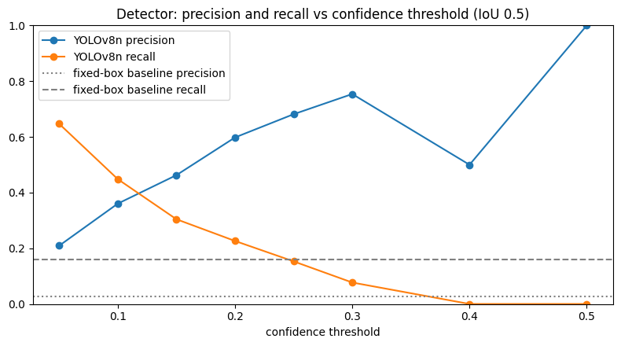
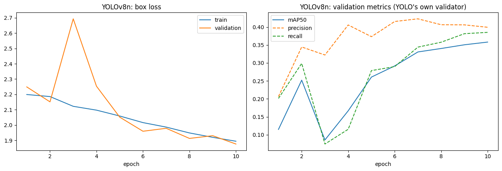

# Chest X-ray Pneumonia Detection | YOLOv8, PyTorch

Detection of pneumonia areas (bounding boxes) on chest X-rays from the [RSNA Pneumonia Detection Challenge](https://www.kaggle.com/competitions/rsna-pneumonia-detection-challenge). A YOLOv8n detector is compared against no-learning baselines, and a ResNet18 classifier is used to test where the errors come from.

       

## 📊 Results

Validation set: 5,337 images (1,203 with pneumonia, 1,898 true boxes). A predicted box counts as correct if IoU ≥ 0.5.

| Detector | Precision | Recall |
|---|---|---|
| Baseline: no boxes | – | 0.000 |
| Baseline: two fixed median boxes on every image | 0.028 | 0.159 |
| **YOLOv8n, confidence ≥ 0.10** | **0.361** | **0.448** |
| YOLOv8n, confidence ≥ 0.25 | 0.681 | 0.153 |

| Image-level classifier ("is there pneumonia?") | PR-AUC |
|---|---|
| Random guess | 0.225 |
| ResNet18, 256 px, seed 42 | 0.666 |
| ResNet18, 256 px, seed 43 | 0.691 |

- YOLOv8n beats the fixed-box baseline on precision and recall at the same time.
- The detector's confidences are low: at 0.25 it is precise but finds few boxes, and at 0.5 it keeps a single box on the whole validation set.
- Most false alarms come from images labeled "No Lung Opacity / Not Normal": 607 false boxes there vs 4 on Normal images. The classifier shows the same pattern, so it is a property of the data rather than of one model.
- The seed alone moves the classifier's PR-AUC by about 0.03, so smaller differences between single runs are treated as noise.
- Examples show duplicate overlapping boxes on correct areas and misses on small boxes.

<!-- >>> IMAGE: put det1_conf_tradeoff.png (from the Kaggle notebook's Output tab) into the images/ folder <<< -->

At thresholds of 0.4 and above the model keeps only 1–2 boxes, so precision there is not meaningful.

<!-- >>> IMAGE: put det1_curves.png (from the Kaggle notebook's Output tab) into the images/ folder <<< -->

<!-- >>> IMAGE: put examples_det1.png (from the Kaggle notebook's Output tab) into the images/ folder <<< -->

## 🛠️ Approach

1. **Data.** 26,684 DICOM images, 1024×1024. 22.5% have pneumonia (1–4 boxes each); the rest are Normal or "Not Normal". Stratified 80/20 split by these three classes.
2. **Preprocessing.** DICOM converted to 512×512 PNG with boxes scaled by 0.5. Boxes were checked on images and for bounds, and the YOLO label files were read back and drawn.
3. **Metric.** Hand-written IoU (checked on known cases) and per-class true/false positives at IoU ≥ 0.5, so baselines and models are scored the same way.
4. **Baselines.** "No boxes" and "two median boxes from the training set on every image".
5. **Classifier.** Pretrained ResNet18, 256 px, 3 epochs, two seeds: used to test which images cause false alarms and to measure run-to-run noise.
6. **Detector.** Pretrained YOLOv8n, 512 px, 10 epochs, evaluated with the same metric as the baselines.

## ⚠️ Limitations

- One detector run with the smallest model and 10 epochs; mAP50 was still rising slightly at the last epoch.
- Only 1,203 validation images contain pneumonia, so small differences may be noise.
- Confidence thresholds were compared on the validation set itself, with no separate test set and no Kaggle leaderboard submission.
- The competition metric is stricter (averaged over IoU 0.4–0.75); this project uses a single IoU threshold of 0.5.
- The split is by patientId; it cannot be verified that one person has no several IDs.
- The classifier and the detector were not combined (e.g. the classifier as a filter for false alarms).
- GPU training is not fully deterministic. The notes inside the notebook were written after an earlier run; this README uses the numbers of the published run.

## ▶️ How to run

Open the notebook on Kaggle with the competition data attached, enable GPU and Internet (pip install and pretrained weights), and Run All (about 1.5–2 hours, mostly DICOM conversion and YOLO training).
Outputs in `/kaggle/working`: `results.csv` and `results_boxes.csv` (box metrics per class), `results_classifier.csv`, the three figures above and `runs/` (model weights).
